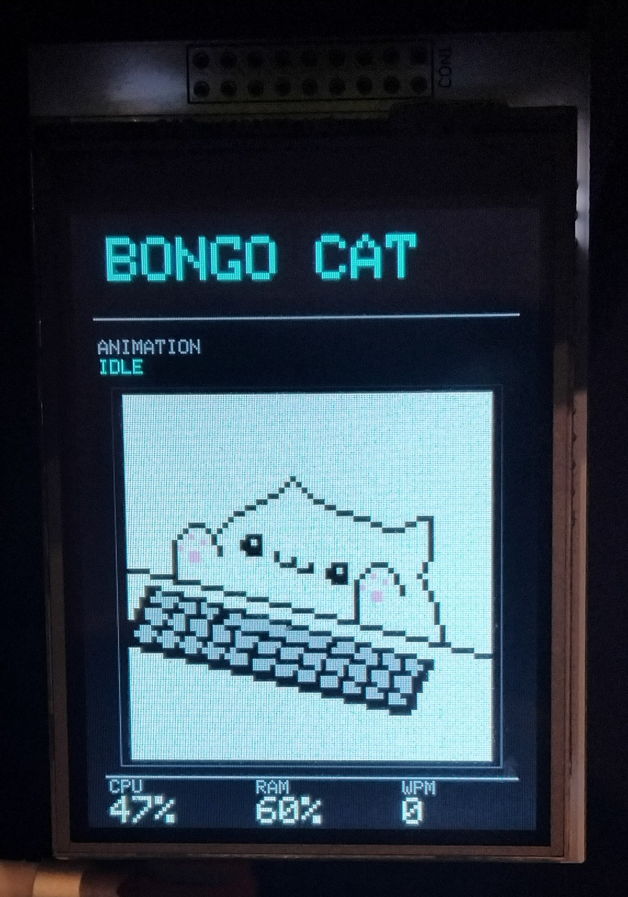

# Bongo Cat Arduino Mega

A physical Bongo Cat that lives on an Arduino Mega 2560 with a Whadda WPSH412 TFT shield (ILI9341, 240x320) and a PC controller written in Python. The Arduino displays animated cat frames from an SD card, and the Python app sends serial commands based on your keyboard/mouse activity, system stats, and it has touch input.

## Original project

This is a port of [vostoklabs/bongo_cat_monitor](https://github.com/vostoklabs/bongo_cat_monitor) for the Arduino Mega. It is not remotely as fast or polished as the original, but it works as a standalone hardware display.

## Preview



## Project structure

```
BongoCatArduinoMega/
├── README.md
├── SDCard/
│   ├── FRAMES/        # 64x64 RGB565 frame images (.RGB)
│   └── DELTAS/        # Precomputed transitions (.DLT, generated by make_deltas.py)
├── Arduino/
│   └── BongoMega_v1.0/
│       └── BongoMega_v1.0.ino   # Arduino sketch
├── PC/
│   ├── bongo_pc.exe         # Compiled Windows executable (ready to run)
│   ├── bongo_pc.py          # Python source
│   ├── bongo_pc.spec        # PyInstaller spec
│   └── Start.bat            # Quick-launch batch file for python script
├── Dev stuff/
│   ├── animations/          # Original frames from original repository in C
│   ├── Custom/              # Custom frames made by me
│   ├── make_deltas.py       # Delta generation script
│   ├── output_frames/       # RGB and PNG generated frames
│   ├── sprite_converter_FromC-Files.py
│   └── sprite_converter_FromPNG.py
└── Stuff/
    ├── __pycache__/
    └── build/               # PyInstaller build artifacts
```

## Hardware

- Arduino Mega 2560
- Whadda WPSH412 TFT shield (ILI9341, 240x320, MCUFRIEND_kbv)
- Built-in SD card reader (software SPI)
- Resistive touch screen on the shield

### SD card wiring (software SPI)

| Signal | Arduino Mega Pin |
|--------|------------------|
| CS     | 10               |
| MOSI   | 11               |
| MISO   | 12               |
| SCK    | 13               |

### Touch screen pins (Whadda WPSH412 on Mega)

| Pin | Arduino Mega |
|-----|--------------|
| XP  | 8            |
| YP  | A3           |
| XM  | A2           |
| YM  | 9            |

## SD card structure

Frames are raw RGB565 little-endian, 64x64 pixels = 8192 bytes each. Deltas are optional transition files that update only changed regions for smoother/faster animation. If a delta is missing or invalid, the Arduino falls back to drawing the full frame.

```
SD/
├── FRAMES/
│   ├── IDLE1.RGB
│   ├── IDLE2.RGB
│   ├── IDLE3.RGB
│   ├── SLEEP1.RGB
│   ├── SLEEP2.RGB
│   ├── SLEEP3.RGB
│   ├── BLINK.RGB
│   ├── EAR.RGB
│   ├── TYPE_L.RGB
│   ├── TYPE_UP.RGB
│   ├── TYPE_R.RGB
│   ├── FAST_L.RGB
│   ├── FAST_UP.RGB
│   ├── FAST_R.RGB
│   ├── HAPPY_L.RGB
│   ├── HAPPY_UP.RGB
│   ├── HAPPY_R.RGB
│   ├── PET1.RGB
│   └── PET2.RGB
└── DELTAS/
    └── 00_01.DLT ...
```

## Serial protocol (115200 baud)

The Python PC controller sends these commands over serial:

| Command | Description |
|---------|-------------|
| `SPEED:<n>` | Set typing speed (1-140). Higher = faster animation. 0 or negative = idle. |
| `STOP` | Return to idle |
| `IDLE_START` / `IDLE` | Enter idle mode |
| `HEARTBEAT` | Keep-alive (sent every 5s by Python) |
| `STREAK_ON` | Activate streak mode (happy cat) |
| `STREAK_OFF` | Deactivate streak mode |
| `STATS:CPU:<n>,RAM:<n>,WPM:<n>` | System metrics displayed on TFT |
| `PET:ON` | Start petting animation |
| `PET:OFF` | Stop petting |
| `ROTATION:<0\|2>` | Screen rotation: 0 = normal, 2 = upside down |

## Arduino side (`Arduino/BongoMega_v1.0/BongoMega_v1.0.ino`)

### States

- **IDLE** – Blinking cat, ear twitch every 12s
- **TYPING** – Cat types (TYPE_L/UP/R or FAST_* if WPM ≥ 70)
- **STREAK** – Happy cat animation (HAPPY_L/UP/R)
- **SLEEPING** – Sleeps after 60s of inactivity (SLEEP1/2/3)
- **PET** – Petting animation (PET1↔PET2), triggered by touch or serial

### Touch

Touching the top half of the screen starts petting; lifting your finger stops it. The touch is rotation-aware (top half is always the physical top, even upside down).

### Rotation

Rotation can be changed at runtime via `ROTATION:<0\|2>`. The Arduino does a full UI + frame redraw so nothing gets corrupted.

## PC side (`PC/`)

A Tkinter-based controller with system tray support.

### Quick start (Windows)

Double-click `PC/Start.bat` or run `PC/bongo_pc.exe` directly — no Python installation needed.

### From source

```bash
pip install psutil serial pynput pystray pillow
python PC/bongo_pc.py           # Opens same app but with terminal for debugging and allows for faster edits of the code
```

### Features

- **Config UI** – Serial port, baud rate, update/heartbeat/idle/typing timeouts, fast-typing WPM threshold, min/max animation speed, rotation
- **Selectable metrics** – Show/hide CPU, RAM, WPM, GPU load/temp, CPU temp, watts in the live readout (Currently they do nothing and its only CPU, RAM and WPM displayed constantly)
- **System tray** – Hide to tray (Show/Hide/Exit); closing the window minimizes to tray
- **PET buttons** – PET ON / PET OFF to manually trigger petting (Useful for debugging if petting works eliminating SD card issue)
- **Config persistence** – All settings saved to `bongo_config.json` next to the executable/script
- **Auto-reconnect** – Serial reconnects automatically if the Arduino is disconnected

### Config file (`bongo_config.json`)

Created automatically on first run in the same folder as the executable:

```json
{
  "serial_port": "AUTO",
  "baud_rate": 115200,
  "update_interval": 1.0,
  "heartbeat_interval": 5.0,
  "idle_timeout": 0.2,
  "typing_timeout": 0.2,
  "fast_typing_wpm": 60,
  "min_animation_speed": 1,
  "max_animation_speed": 10,
  "rotation": 0,
  "show_cpu": true,
  "show_ram": true,
  "show_wpm": true,
  "show_gpu_load": false,
  "show_gpu_temp": false,
  "show_cpu_temp": false,
  "show_watts": false
}
```

## Installation

1. Wire the Arduino Mega to the WPSH412 shield and insert an SD card with the `FRAMES/` and `DELTAS/` folders from `SDCard/`.
2. Install Arduino libraries: `MCUFRIEND_kbv`, `SdFat` (2.3.0), `Adafruit_GFX`, `TouchScreen`, `SoftSPI`.
3. Upload `Arduino/BongoMega_v1.0/BongoMega_v1.0.ino` to the Arduino Mega.
4. On PC, run `PC/bongo_pc.exe` (no install needed) or `PC/bongo_pc.py` with Python dependencies installed.

## Troubleshooting

| Issue | Fix |
|-------|-----|
| Screen blank / corrupted after rotation | Re-upload the `.ino`; rotation does a full frame reload now |
| Touch requires hard press | Adjust `TOUCH_RX` (lower = more sensitive) and `TOUCH_MINPRESSURE` in the `.ino` |
| Touch blinks while holding | Ensure you're using the latest `.ino` with release debounce (500ms) (It could also be screen not detecting sometimes touch issue which is known on mega as UNO functions normally) |
| CPU/RAM/WPM not updating on screen | Make sure the PC app shows "Connected" and the Arduino is receiving `STATS:` commands |
| SD ERROR on boot | Check SD card is formatted FAT32 and `FRAMES/` files exist |
| PC app can't find Arduino | Use `Start.bat` or specify `--port COMx` manually |
| Arduino UNO doesn't work properly | Currently i have not tested Arduino UNO so it might require small rewrite of the code and separate version for proper pinout and stuff (some libraries require editing for mega which UNO might not like |

## Files

- `Arduino/BongoMega_v1.0/BongoMega_v1.0.ino` – Arduino sketch
- `PC/bongo_pc.exe` / `PC/bongo_pc.py` – PC controller (compiled exe + source)
- `SDCard/` – Frame and delta files for the SD card
- `Dev stuff/make_deltas.py` – Delta generation script
- `Dev stuff/sprite_converter_FromPNG.py` – PNG to RGB565 converter
